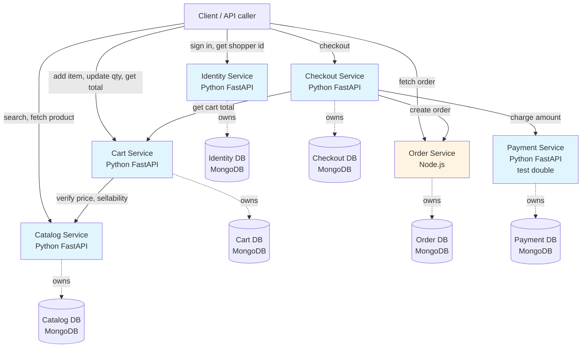

# HLD — A shopper browses a catalog, checks out, and receives a paid order

## Overview

Six independent services — identity, catalog, cart, checkout, payment, and order — cooperate to turn a product search into a paid order the client can retrieve. Each service owns its data and exposes HTTP endpoints. No service reads or writes another service's database. Every service publishes Swagger UI at `/docs`.

## Design paradigm

**Microservices with strict data ownership.** Each service is a separate process with its own MongoDB database. Services communicate only through HTTP APIs. No shared database, no direct database access across service boundaries.

## Service architecture



## Architecture decisions

### AD-1: Data isolation

**Binds:** Each service MUST have its own MongoDB database. No service may read or write another service's database.

**Prevents:** Tight coupling, cascading schema changes, and runtime dependencies that break service boundaries.

**Rule:** Inter-service data access goes through HTTP APIs only.

**Status:** `[ADOPTED]` — AC-10 requires this.

---

### AD-2: HTTP-only inter-service communication

**Binds:** Services communicate only via synchronous HTTP calls. No message queue, no event bus, no shared memory.

**Prevents:** Introduction of infrastructure the job does not require and additional failure modes.

**Rule:** When service A needs data from service B, A calls B's HTTP endpoint.

**Status:** `[ADOPTED]` — The job states "All of this is HTTP APIs."

---

### AD-3: Price authority

**Binds:** Catalog is the source of truth for product price. Cart, checkout, and order store snapshots of the price at the time of the operation.

**Prevents:** Price divergence when a product's price changes after the client sees it.

**Rule:** Cart calls catalog to get the current price when computing totals. Checkout captures the cart total at checkout time and sends that amount to payment. Order stores the total charged.

**Status:** `[ADOPTED]` — AC-3, AC-5, AC-6.

---

### AD-4: Payment test double

**Binds:** Payment service is a deterministic test double that accepts or refuses a charge based on configurable rules (e.g. amount, card number pattern).

**Prevents:** External payment provider dependency in v1.

**Rule:** Payment service exposes `POST /charge` with amount and returns `{status: "accepted", reference: "..."}` or `{status: "refused", reason: "..."}`.

**Status:** `[ADOPTED]` — Assumption in ticket.

---

### AD-5: Money representation

**Binds:** All services represent money as an integer in minor units (e.g. cents for USD). Currency is implicit (single merchant, single currency).

**Prevents:** Floating-point rounding errors and currency mismatches.

**Rule:** Catalog, cart, checkout, payment, and order all store and transmit amounts as integers (minor units).

**Status:** `[ADOPTED]` — "Money is the catalog currency, in minor units" in Boundaries.

---

### AD-6: Guest vs. signed-in checkout

**Binds:** Checkout accepts either a shopper ID (signed-in) or email + ship-to address (guest). No account is created for guests.

**Prevents:** Forcing account creation for one-time buyers.

**Rule:** Checkout requests include optional `shopper_id` (from identity). When absent, `email` and `ship_to` are required. Order stores whichever was provided.

**Status:** `[ADOPTED]` — AC-5, AC-6, and assumption.

---

### AD-7: Cart lifecycle

**Binds:** A cart is emptied when checkout succeeds (payment accepts). A cart is unchanged when payment refuses.

**Prevents:** Double-charging or losing the cart contents on payment failure.

**Rule:** Checkout calls `DELETE /cart/{cart_id}` only after payment returns `accepted` and the order is created.

**Status:** `[ADOPTED]` — AC-7, AC-8.

---

### AD-8: Service stack split

**Binds:** Identity, catalog, cart, checkout, and payment are Python 3.12 + FastAPI. Order is Node.js with its own HTTP framework and MongoDB driver.

**Prevents:** None — this is a given constraint.

**Rule:** Each service directory contains its own `requirements.txt` (Python) or `package.json` (Node.js), main entry point, and database connection config.

**Status:** `[ADOPTED]` — Repo context mandates this.

---

### AD-9: Swagger UI per service

**Binds:** Every service exposes Swagger UI at `GET /docs`.

**Prevents:** Opaque APIs and manual endpoint discovery.

**Rule:** FastAPI services enable `docs_url="/docs"`. Node.js order service uses `swagger-ui-express` or equivalent at `/docs`.

**Status:** `[ADOPTED]` — AC-11.

---

## Service contracts

### Catalog Service (Python FastAPI)

**File paths:** `app/catalog/main.py`, `app/catalog/requirements.txt`, `app/catalog/models.py`, `app/catalog/routes.py`, `app/catalog/db.py`

**Owns:** Products, prices, sellability.

**Database:** `catalog_db` (MongoDB).

**Collections:**
- `products`: `{_id, name, price_minor_units, sellable, ...}`

**API:**

- `GET /products/search?q={query}` → `[{id, name, price_minor_units, sellable}, ...]`
- `GET /products/{product_id}` → `{id, name, price_minor_units, sellable, ...}`
- `GET /docs` → Swagger UI

**Outcome:** Returns product name, price (integer, minor units), and sellable flag. AC-1, AC-2.

---

### Cart Service (Python FastAPI)

**File paths:** `app/cart/main.py`, `app/cart/requirements.txt`, `app/cart/models.py`, `app/cart/routes.py`, `app/cart/db.py`

**Owns:** Client carts and line items.

**Database:** `cart_db` (MongoDB).

**Collections:**
- `carts`: `{_id, lines: [{product_id, quantity, price_snapshot_minor_units}], total_minor_units, ...}`

**API:**

- `POST /cart` → `{cart_id}`
- `GET /cart/{cart_id}` → `{cart_id, lines: [{product_id, quantity, price_minor_units}], total_minor_units}`
- `POST /cart/{cart_id}/items` body `{product_id, quantity}` → `{cart_id, lines, total_minor_units}`
  - Calls `GET /products/{product_id}` on catalog to verify sellability and fetch current price.
  - Rejects if `sellable: false` with `{error: "Product cannot be added", reason: "..."}`. AC-2.
- `PATCH /cart/{cart_id}/items/{product_id}` body `{quantity}` → `{cart_id, lines, total_minor_units}`
  - When quantity is zero, removes the line. AC-4.
- `DELETE /cart/{cart_id}` → `204 No Content`
- `GET /docs` → Swagger UI

**Outcome:** Cart total is sum of `price_snapshot_minor_units * quantity` for all lines. AC-3, AC-4.

---

### Identity Service (Python FastAPI)

**File paths:** `app/identity/main.py`, `app/identity/requirements.txt`, `app/identity/models.py`, `app/identity/routes.py`, `app/identity/db.py`

**Owns:** Shopper accounts and sign-in.

**Database:** `identity_db` (MongoDB).

**Collections:**
- `shoppers`: `{_id, email, password, ...}`

**API:**

- `POST /sign-in` body `{email, password}` → `{shopper_id, token}` (token may be a simple stub in v1)
- `GET /shoppers/{shopper_id}` → `{shopper_id, email, ...}`
- `GET /docs` → Swagger UI

**Outcome:** Returns a shopper ID checkout and order can reference. AC-6.

---

### Checkout Service (Python FastAPI)

**File paths:** `app/checkout/main.py`, `app/checkout/requirements.txt`, `app/checkout/models.py`, `app/checkout/routes.py`, `app/checkout/db.py`

**Owns:** Checkout sessions (ephemeral, may log attempts but no persistent state required beyond what payment and order capture).

**Database:** `checkout_db` (MongoDB) — may be empty or used for idempotency keys; checkout is stateless.

**API:**

- `POST /checkout` body `{cart_id, shopper_id?, email?, ship_to?}` → `{order_id, status, ...}` or `{error, reason}`
  1. Calls `GET /cart/{cart_id}` to get total and lines.
  2. Calls `POST /payment/charge` with `{amount_minor_units: cart.total_minor_units, ...}`.
  3. If payment returns `accepted`:
     - Calls `POST /orders` with `{shopper_id?, email?, ship_to, lines, total_minor_units, payment_reference}`.
     - Calls `DELETE /cart/{cart_id}`.
     - Returns `{order_id, status: "paid"}`. AC-8.
  4. If payment returns `refused`:
     - Returns `{status: "refused", reason: payment.reason}`. AC-7.
- `GET /docs` → Swagger UI

**Outcome:** Orchestrates cart → payment → order. AC-5, AC-6, AC-7, AC-8.

---

### Payment Service (Python FastAPI, test double)

**File paths:** `app/payment/main.py`, `app/payment/requirements.txt`, `app/payment/models.py`, `app/payment/routes.py`, `app/payment/db.py`

**Owns:** Charge records.

**Database:** `payment_db` (MongoDB).

**Collections:**
- `charges`: `{_id, amount_minor_units, status, reference, timestamp, ...}`

**API:**

- `POST /charge` body `{amount_minor_units, card?, ...}` → `{status: "accepted", reference}` or `{status: "refused", reason}`
  - Test double logic: accept if amount < 100000 minor units and card number (if provided) does not end in "0000"; refuse otherwise.
- `GET /docs` → Swagger UI

**Outcome:** Deterministic accept/refuse for testing. AC-7, AC-8.

---

### Order Service (Node.js)

**File paths:** `app/order/index.js`, `app/order/package.json`, `app/order/models.js`, `app/order/routes.js`, `app/order/db.js`

**Owns:** Paid orders.

**Database:** `order_db` (MongoDB).

**Collections:**
- `orders`: `{_id, shopper_id?, email?, ship_to, lines, total_minor_units, payment_reference, created_at, ...}`

**API:**

- `POST /orders` body `{shopper_id?, email?, ship_to, lines, total_minor_units, payment_reference}` → `{order_id}`
- `GET /orders/{order_id}` → `{order_id, shopper_id?, email?, ship_to, lines, total_minor_units, payment_reference, created_at}`. AC-9.
- `GET /docs` → Swagger UI (via `swagger-ui-express` or equivalent)

**Outcome:** Stores and retrieves the final paid order. AC-9.

---

## Data schemas

### Catalog

```json
{
  "_id": "ObjectId",
  "name": "string",
  "price_minor_units": "integer",
  "sellable": "boolean"
}
```

### Cart

```json
{
  "_id": "string (cart_id)",
  "lines": [
    {
      "product_id": "string",
      "quantity": "integer",
      "price_snapshot_minor_units": "integer"
    }
  ],
  "total_minor_units": "integer"
}
```

### Identity

```json
{
  "_id": "ObjectId (shopper_id)",
  "email": "string",
  "password": "string"
}
```

### Payment

```json
{
  "_id": "ObjectId",
  "amount_minor_units": "integer",
  "status": "accepted | refused",
  "reference": "string (UUID or stub)",
  "reason": "string (only when refused)",
  "timestamp": "ISODate"
}
```

### Order

```json
{
  "_id": "ObjectId (order_id)",
  "shopper_id": "string (optional)",
  "email": "string (required for guest)",
  "ship_to": {
    "street": "string",
    "city": "string",
    "postal_code": "string",
    "country": "string"
  },
  "lines": [
    {
      "product_id": "string",
      "quantity": "integer",
      "price_minor_units": "integer"
    }
  ],
  "total_minor_units": "integer",
  "payment_reference": "string",
  "created_at": "ISODate"
}
```

---

## Directory structure (seed)

```
app/
├── identity/
│   ├── main.py
│   ├── requirements.txt
│   ├── models.py
│   ├── routes.py
│   └── db.py
├── catalog/
│   ├── main.py
│   ├── requirements.txt
│   ├── models.py
│   ├── routes.py
│   └── db.py
├── cart/
│   ├── main.py
│   ├── requirements.txt
│   ├── models.py
│   ├── routes.py
│   └── db.py
├── checkout/
│   ├── main.py
│   ├── requirements.txt
│   ├── models.py
│   ├── routes.py
│   └── db.py
├── payment/
│   ├── main.py
│   ├── requirements.txt
│   ├── models.py
│   ├── routes.py
│   └── db.py
└── order/
    ├── index.js
    ├── package.json
    ├── models.js
    ├── routes.js
    └── db.js
```

Each service is a sibling directory under `app/`. All paths resolve from repo root `/home/goos/projects/ecom`.

---

## Risks and mitigations

| Risk | Impact | Mitigation |
|------|--------|----------|
| Catalog price changes between cart view and checkout | Client sees one price, pays another | Cart snapshots price at add-time. Checkout sends the cart total, not a recalculated one. Deferred: price-lock or re-verification before charge. |
| Network failure between checkout → payment → order | Payment succeeds but order not created, or vice versa | Deferred: idempotency keys and retry logic. V1 accepts this as a known gap. |
| Concurrent cart updates | Race condition on quantity change | Deferred: optimistic locking or cart versioning. V1 last-write-wins. |
| Payment test double too simplistic for real testing | Tests pass but real provider fails | Accepted for v1. Mark with `[TEST_DOUBLE]` in code. Future: mock realistic failure modes. |
| No authentication/authorization | Any client can access any cart or order | Deferred. V1 trusts the caller. Mark endpoints as "public, no auth" in Swagger. |

---

## Open questions

None. All AC and service boundaries are defined.

---

## Deferred

- Tax calculation
- Shipping cost
- Coupons and discounts
- Multi-currency support
- Idempotency and retry logic
- Authentication and authorization
- Cart session expiry
- Order history pagination
- Refunds and returns
- Inventory management (stock levels, oversell prevention)
- Search ranking and recommendations
- Admin UI for store operators

---

## Verification against AC

| AC | Coverage | Test location |
|----|----------|---------------|
| AC-1: Find a product | Catalog `GET /products/search`, `GET /products/{id}` returns name, price, sellable. | Story 02-app Tests 1-2 |
| AC-2: Unsellable product cannot be added | Catalog returns price and sellable flag; cart `POST /cart/{id}/items` refuses add with reason when `sellable: false`. | Story 02-app Test 3, Story 03-app Test 3 |
| AC-3: Cart total is catalog price | Cart calls catalog for current price, stores snapshot, computes total as sum of `price_snapshot * qty`. | Story 03-app Tests 2, 6 |
| AC-4: Quantity change recomputes the total | Cart `PATCH /cart/{id}/items/{product_id}` updates or removes line, recomputes total. | Story 03-app Tests 4, 5 |
| AC-5: Guest checkout | Checkout `POST /checkout` accepts `email` and `ship_to` when `shopper_id` absent, sends cart total to payment. | Story 04-app Test 1 |
| AC-6: Signed-in checkout uses the same total | Checkout `POST /checkout` accepts `shopper_id`, sends cart total to payment, passes `shopper_id` to order. | Story 01-app Tests 1, 3; Story 04-app Test 2 |
| AC-7: Payment refused | Checkout returns `{status: "refused", reason}`, cart unchanged. | Story 04-app Tests 3, 4; Story 05-app Tests 2, 3 |
| AC-8: Payment accepted | Checkout creates order via `POST /orders`, empties cart via `DELETE /cart/{id}`. | Story 04-app Tests 1, 2, 5, 6; Story 05-app Test 1; Story 06-app Tests 1, 2 |
| AC-9: Look up the order | Order `GET /orders/{id}` returns all stored fields. | Story 06-app Tests 3, 4 |
| AC-10: Services do not share databases | Each service has its own `*_db` MongoDB database; inter-service data access is HTTP-only (AD-1, AD-2). | Story 02-app Test 6, Story 03-app Test 9, Story 05-app Test 6, Story 06-app Test 6 |
| AC-11: Swagger for every service | All services expose `/docs` (AD-9). | Story 01-app Test 5, Story 02-app Test 5, Story 03-app Test 8, Story 04-app Test 7, Story 05-app Test 5, Story 06-app Test 5 |

**Test count total:** 39 tests (5 + 6 + 9 + 7 + 6 + 6) across six stories, covering all eleven AC plus edge cases and Swagger verification.

---

**End of HLD.**
