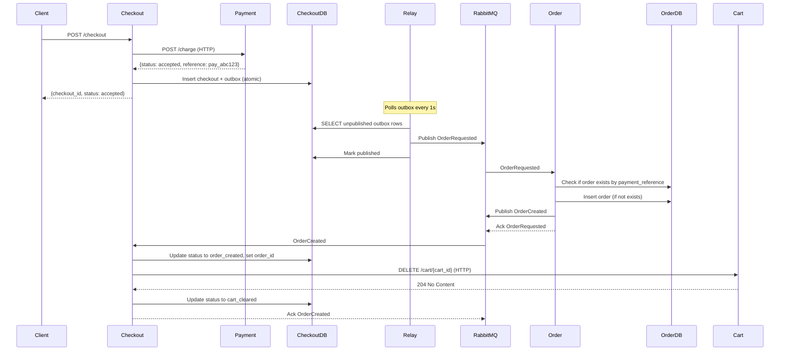
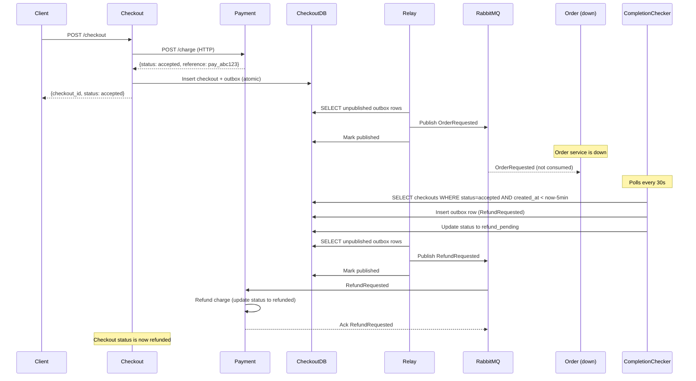
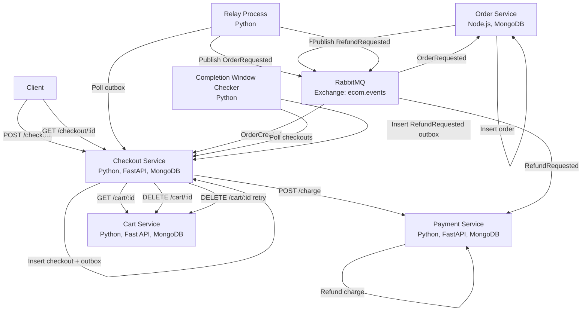
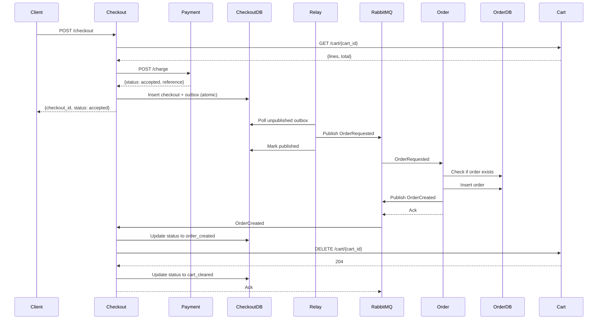

# HLD — PER-278

**Feature:** A paid checkout still becomes one order when order or cart is briefly down  
**Initiative:** `epic-distributed-checkout/`  
**Covers:** CAP-3, CAP-7, CAP-11  
**Altitude:** Feature  
**Date:** 2025-01-10

---

## Overview

Today's checkout is synchronous: cart → payment → order → empty cart in one HTTP chain. When order or cart is briefly down, an accepted charge fails to become an order. This HLD introduces the **outbox pattern** and **event-driven order creation** to decouple checkout from order and cart availability, ensuring that an accepted payment always produces exactly one order, even under transient downstream failures.

---

## Design Paradigm

**Event-Driven Choreography with Outbox**

- **Outbox pattern:** Checkout persists the checkout record and an outbox row atomically in its own MongoDB. A relay process polls unpublished rows and pushes them to RabbitMQ.
- **Event-driven choreography:** Services publish domain events (`OrderRequested`, `OrderCreated`, `RefundRequested`) to RabbitMQ. Consumers react independently. No orchestrator.
- **Idempotency keys:** The payment reference is the idempotency key across checkout, payment, and order. Duplicate submissions or message redeliveries produce one charge and one order.
- **Completion window:** If the order is not created within a configurable window (default 5 minutes), checkout publishes `RefundRequested` and marks the checkout as refunded.

---

## Component Boundaries

### Checkout Service (Python, FastAPI, MongoDB)

**New Responsibilities:**
- After an accepted charge, persist a `checkouts` document and an `outbox` document in one atomic write.
- Expose a status endpoint: `GET /checkout/{checkout_id}` → `{status, order_id}`.
- Consume `OrderCreated` from RabbitMQ, trigger cart deletion with retry, update checkout status to `cart_cleared`.
- Consume `RefundRequested` timeout, call payment service to refund, update checkout status to `refunded`.

**Data Schema:**

```python
# checkouts collection
{
  "_id": ObjectId,
  "checkout_id": str,  # UUID
  "payment_reference": str,  # idempotency key
  "cart_id": str,
  "shopper_id": str | None,
  "email": str,
  "ship_to": {
    "street": str,
    "city": str,
    "postal_code": str,
    "country": str
  },
  "lines": [
    {
      "product_id": str,
      "quantity": int,
      "price_snapshot_minor_units": int
    }
  ],
  "total_minor_units": int,
  "status": "accepted" | "order_created" | "cart_cleared" | "refunded",
  "order_id": str | None,
  "created_at": datetime,
  "updated_at": datetime
}

# outbox collection
{
  "_id": ObjectId,
  "event_type": "OrderRequested" | "RefundRequested",
  "payload": dict,  # message body
  "payment_reference": str,  # for idempotency
  "published": bool,
  "published_at": datetime | None,
  "created_at": datetime
}
```

**New Endpoints:**
- `GET /checkout/{checkout_id}` → `{checkout_id, status, order_id?, created_at}`

**Modified Endpoints:**
- `POST /checkout` → after payment accepts, insert checkout + outbox row atomically, return `{checkout_id, status: "accepted"}` immediately (no order_id yet).

**Cart Deletion with Retry:**
- On `OrderCreated`, attempt `DELETE /cart/{cart_id}` (verify path in `repo-outline/app`).
- If the delete fails (network error, cart service down), log the failure and schedule a retry (exponential backoff, max 3 retries over 1 minute).
- Do not create the order again on retry.

---

### Order Service (Node.js, MongoDB)

**New Responsibilities:**
- Consume `OrderRequested` from RabbitMQ.
- Create one order per payment reference (idempotency: check existing order by `payment_reference` before inserting).
- Publish `OrderCreated` to RabbitMQ after successful insertion.

**Data Schema:**

```javascript
// orders collection (existing shape, new field added)
{
  _id: ObjectId,
  order_id: string,  // UUID
  payment_reference: string,  // NEW: idempotency key
  shopper_id: string | null,
  email: string,
  ship_to: {
    street: string,
    city: string,
    postal_code: string,
    country: string
  },
  lines: [
    {
      product_id: string,
      quantity: number,
      price_snapshot_minor_units: number
    }
  ],
  total_minor_units: number,
  created_at: Date
}
```

**Idempotency:**
- Before inserting, query `orders` collection by `payment_reference`.
- If exists, skip insertion and publish `OrderCreated` with the existing order_id (message redelivery safety).

---

### Payment Service (Python, FastAPI, MongoDB)

**New Responsibilities:**
- Consume `RefundRequested` from RabbitMQ.
- Refund the charge identified by `payment_reference`.
- Publish `RefundCompleted` (optional, for observability; not required by AC).

**Data Schema:**

```python
# charges collection (existing shape, new field added)
{
  "_id": ObjectId,
  "reference": str,  # existing
  "amount_minor_units": int,
  "card": str | None,
  "status": "accepted" | "refused" | "refunded",  # NEW: refunded
  "refunded_at": datetime | None,  # NEW
  "timestamp": datetime
}
```

**Refund Logic:**
- Idempotency: if `status == "refunded"`, skip and return success.
- Otherwise, update `status` to `refunded`, set `refunded_at`, return success.

---

### Cart Service (Python, FastAPI, MongoDB)

**No Changes to API or Data Schema.**

Checkout still calls `GET /cart/{cart_id}` and `DELETE /cart/{cart_id}` (verify paths in `repo-outline/app`). The delete is now retried on failure.

---

### Relay Process (Python)

**New Component.**

**Responsibility:**
- Poll the `outbox` collection in checkout's MongoDB for unpublished rows (`published == false`).
- Publish each row's payload to RabbitMQ.
- Mark the row as published (`published = true`, `published_at = now`).

**Deployment:**
- Standalone Python script, runs as a separate process (e.g. systemd service, Docker container, or Kubernetes pod).
- Polls every 1 second (configurable).

**Idempotency:**
- RabbitMQ publisher confirms: only mark published after RabbitMQ acks.
- If the relay crashes after publishing but before marking, the message is published again (RabbitMQ duplicate). Consumers must handle duplicates.

---

### Completion Window Checker (Python)

**New Component.**

**Responsibility:**
- Poll the `checkouts` collection for rows with `status == "accepted"` and `created_at < now - completion_window`.
- For each expired checkout, insert an `outbox` row with `event_type: "RefundRequested"`.
- Update checkout `status` to `refund_pending`.

**Deployment:**
- Standalone Python script, runs as a separate process (e.g. cron job, systemd timer, or background worker).
- Polls every 30 seconds (configurable).

**Completion Window:**
- Default: 5 minutes (configurable via environment variable `COMPLETION_WINDOW_SECONDS`).

---

## Message Schemas

### OrderRequested

**Published by:** Checkout (via relay)  
**Consumed by:** Order  
**Routing key:** `order.requested`

```json
{
  "event_type": "OrderRequested",
  "payment_reference": "pay_abc123",
  "checkout_id": "chk_xyz789",
  "shopper_id": "507f1f77bcf86cd799439011",
  "email": "shopper@example.com",
  "ship_to": {
    "street": "123 Main St",
    "city": "Springfield",
    "postal_code": "12345",
    "country": "US"
  },
  "lines": [
    {
      "product_id": "prod_001",
      "quantity": 2,
      "price_snapshot_minor_units": 1500
    }
  ],
  "total_minor_units": 3000,
  "timestamp": "2025-01-10T14:30:00Z"
}
```

**Field Note:** `price_snapshot_minor_units` (integer, required): Mapped to `price_minor_units` in the order document on insert.

---

### OrderCreated

**Published by:** Order  
**Consumed by:** Checkout  
**Routing key:** `order.created`

```json
{
  "event_type": "OrderCreated",
  "payment_reference": "pay_abc123",
  "checkout_id": "chk_xyz789",
  "order_id": "ord_def456",
  "timestamp": "2025-01-10T14:30:05Z"
}
```

---

### RefundRequested

**Published by:** Checkout (via relay, triggered by completion window checker)  
**Consumed by:** Payment  
**Routing key:** `payment.refund.requested`

```json
{
  "event_type": "RefundRequested",
  "payment_reference": "pay_abc123",
  "checkout_id": "chk_xyz789",
  "timestamp": "2025-01-10T14:35:00Z"
}
```

## RabbitMQ Topology

**Exchange:** `ecom.events` (type: `topic`)

**Queues:**
- `order.requested.queue` → binds to `order.requested`
- `order.created.queue` → binds to `order.created`
- `payment.refund.requested.queue` → binds to `payment.refund.requested`

**Durability:**
- Exchange: durable
- Queues: durable
- Messages: persistent (`delivery_mode=2`)

**Acknowledgements:**
- Manual acks. Consumers ack after processing (insert, update, or idempotency check).

**Dead Letter Queue (DLQ):**
- Each queue has a DLQ for messages that fail after 3 retries (configurable `x-message-ttl` and `x-max-length`).

---

## Service Interaction Contracts

### Checkout → Payment (HTTP, unchanged)

**Endpoint:** `POST http://localhost:8005/charge` (verify URL in `repo-outline/app`)  
**Request:**
```json
{
  "amount_minor_units": 3000,
  "card": "4111111111111111"
}
```
**Response:**
```json
{
  "status": "accepted",
  "reference": "pay_abc123"
}
```

**Idempotency:** 
Assumption: Checkout implements idempotency by querying its own database before calling payment. Before calling `POST /charge`, checkout queries the `checkouts` collection for any checkout with the same `cart_id` and status `accepted`, `order_created`, or `cart_cleared`. If one exists, checkout returns that existing checkout to the client and does not call payment. Otherwise, checkout calls payment once, receives `payment_data["reference"]`, then inserts the checkout record and outbox row atomically, using that reference as the idempotency key. Payment generates a fresh reference on every call and does not accept or honor an idempotency key in v1. Mark this as `[IDEMPOTENCY_DEFERRED]`.

---

### Checkout → Cart (HTTP, unchanged)

**Endpoints:**
- `GET http://localhost:8003/cart/{cart_id}` → fetch cart lines and total (verify URL in `repo-outline/app`)
- `DELETE http://localhost:8003/cart/{cart_id}` → empty the cart

**Retry:** Checkout retries the DELETE on failure (exponential backoff, max 3 retries over 1 minute).

---

### Checkout → Order (async, via RabbitMQ)

**Message:** `OrderRequested`  
**No HTTP calls** between checkout and order.

---

### Order → Checkout (async, via RabbitMQ)

**Message:** `OrderCreated`  
**No HTTP calls** between order and checkout.

---

### Checkout → Payment (async, via RabbitMQ)

**Message:** `RefundRequested`  
**No HTTP calls** for refunds.

## Data Flow: Accepted Checkout → Order Created → Cart Cleared



---

## Data Flow: Order Service Down → Completion Window → Refund



---

## Idempotency

### Checkout Service

**Duplicate Submission:**
- Key: `payment_reference`
- Before inserting a new checkout, query the `checkouts` collection by `payment_reference`.
- If exists and status is `accepted`, `order_created`, or `cart_cleared`: return the existing checkout_id and status (do not call payment again).
- If exists and status is `refunded`: return an error (checkout was refunded, cannot retry).
- If not exists: proceed with payment and insertion.

**Duplicate Message Delivery (`OrderCreated`):**
- Idempotency: update checkout status and order_id by `payment_reference`.
- If status is already `order_created` or `cart_cleared`, skip the update and ack the message.

---

### Order Service

**Duplicate Message Delivery (`OrderRequested`):**
- Key: `payment_reference`
- Before inserting, query the `orders` collection by `payment_reference`.
- If exists: skip insertion, publish `OrderCreated` with the existing order_id, ack the message.
- If not exists: insert the order, publish `OrderCreated`, ack the message.

---

### Payment Service

**Duplicate Refund Request (`RefundRequested`):**
- Key: `payment_reference`
- Before refunding, query the `charges` collection by `reference`.
- If `status == "refunded"`: skip the refund, ack the message.
- If `status == "accepted"`: update to `refunded`, set `refunded_at`, ack the message.

---

## Error Handling

### Payment Refused (AC1)

**Flow:**
- Checkout calls `POST /charge`, payment returns `{status: refused}`.
- Checkout returns `{status: refused, reason: ...}` immediately.
- No checkout record, no outbox row, no message published.
- Cart unchanged.

---

### Order Service Down (AC3)

**Flow:**
- Checkout publishes `OrderRequested` to RabbitMQ.
- Order service is down; message remains in queue.
- When order service recovers, it consumes the message, creates the order, publishes `OrderCreated`.

---

### Cart Delete Failure (AC5)

**Flow:**
- Checkout receives `OrderCreated`, updates status to `order_created`.
- Attempts `DELETE /cart/{cart_id}`.
- If delete fails (network error, cart service down):
  - Log the failure (verify logging in `repo-outline/app`).
  - Schedule a retry (exponential backoff: 5s, 10s, 20s).
  - Ack the `OrderCreated` message (do not block other checkouts).
- On retry success: update status to `cart_cleared`.
- On final retry failure: leave status as `order_created`, log a warning (manual intervention may be needed).

---

### Completion Window Exceeded (AC6)

**Flow:**
- Completion window checker finds checkouts with `status == "accepted"` and `created_at < now - 5 minutes`.
- Inserts an `outbox` row with `event_type: "RefundRequested"`.
- Updates checkout status to `refund_pending`.
- Relay publishes `RefundRequested`.
- Payment service refunds the charge.
- Checkout status is updated to `refunded` (by payment service or by completion checker polling payment status — TBD).

**Open Question:** Does payment service publish a `RefundCompleted` event, or does the completion checker poll payment status to update checkout to `refunded`?

---

## Rollback and Recovery

### Relay Process Crash

**Before publishing to RabbitMQ:**
- Outbox row remains unpublished.
- When relay restarts, it re-polls and publishes the message.

**After publishing, before marking published:**
- Message is in RabbitMQ, outbox row still unpublished.
- Relay re-polls and publishes again (duplicate).
- Order service handles duplicates via idempotency (payment_reference).

---

### Order Service Crash

**Before inserting order:**
- Message remains in RabbitMQ queue (not acked).
- When order service restarts, it re-consumes the message.

**After inserting order, before publishing `OrderCreated`:**
- Order exists, `OrderCreated` not published.
- When order service restarts, it re-consumes `OrderRequested`, finds the order already exists (idempotency), publishes `OrderCreated`.

---

### Checkout Service Crash

**Before inserting checkout + outbox:**
- Client receives a 5xx error.
- No checkout record, no outbox row.
- Client retries with the same payment reference (if implemented client-side).
- Checkout detects duplicate by payment_reference and returns the existing checkout.

**After inserting, before returning response:**
- Checkout and outbox exist.
- Client may not receive the response (network error).
- Client retries; checkout detects duplicate by payment_reference and returns the existing checkout.

---

## Risks and Mitigations

### R1: Outbox relay fails to publish a message

**Risk:** Relay crashes or is killed before marking an outbox row as published.  
**Impact:** Message is published twice. Order service creates one order (idempotency). Low risk.  
**Mitigation:** Order service handles duplicates via `payment_reference`.

---

### R2: RabbitMQ is down

**Risk:** Relay cannot publish messages; messages pile up in the outbox.  
**Impact:** Orders are not created until RabbitMQ recovers. Completion window may expire, triggering refunds.  
**Mitigation:** Monitor RabbitMQ health. Set completion window to 5 minutes (longer than typical RabbitMQ downtime). Alert on outbox backlog.

---

### R3: Completion window too short

**Risk:** Order service is slow; completion window expires before the order is created.  
**Impact:** Checkout refunds the charge; order appears later (orphaned order).  
**Mitigation:** Set completion window to 5 minutes (configurable). Monitor order creation latency. If p99 latency approaches 5 minutes, increase the window.

---

### R4: Cart delete retry exhausted

**Risk:** Cart service is down for >1 minute; all retries fail.  
**Impact:** Order exists, cart not deleted. Shopper sees a non-empty cart after checkout.  
**Mitigation:** Log a warning. Manual intervention (ops deletes the cart). Future: add a background job to retry cart deletes indefinitely.

---

### R5: Duplicate checkout submission charges twice

**Risk:** Client retries checkout with a new payment reference.  
**Impact:** Two charges, two orders.  
**Mitigation:** Client-side idempotency: clients should generate a stable payment reference per checkout attempt (e.g. hash of cart_id + shopper_id + timestamp). Server-side: checkout detects duplicates by payment_reference.

---

### R6: Message ordering

**Risk:** `OrderCreated` arrives before `OrderRequested` (network reordering, relay delay).  
**Impact:** Checkout receives `OrderCreated` before it has stored the checkout.  
**Mitigation:** Checkout ignores `OrderCreated` for unknown payment references (log a warning). When `OrderRequested` is processed later, the order already exists, and `OrderCreated` is published again.

---

## Security and Authorization

**[AUTH_DEFERRED]** All endpoints remain public in v1. No change.

**Message Encryption:** RabbitMQ connections use TLS in production (verify in deployment config).

**Access Control:** RabbitMQ virtual host, exchange, and queue permissions are configured to restrict access to the checkout, order, and payment services.

---

## Observability

### Logging

**Checkout:**
- Log checkout creation: `checkout_id`, `payment_reference`, `status`.
- Log outbox insertion: `event_type`, `payment_reference`.
- Log cart delete failure: `cart_id`, `retry_count`.

**Relay:**
- Log each published message: `event_type`, `payment_reference`, `published_at`.

**Order:**
- Log order creation: `order_id`, `payment_reference`.
- Log duplicate detection: `payment_reference`, `existing_order_id`.

**Payment:**
- Log refund: `reference`, `refunded_at`.

**Completion Window Checker:**
- Log expired checkouts: `checkout_id`, `created_at`, `completion_window`.

---

### Metrics

- `checkout.created.count` — total checkouts created.
- `checkout.status.{status}.count` — count per status (accepted, order_created, cart_cleared, refunded).
- `outbox.published.count` — messages published by relay.
- `outbox.pending.count` — unpublished rows in outbox (gauge).
- `order.created.count` — orders created.
- `order.duplicate_detected.count` — duplicate `OrderRequested` messages.
- `payment.refund.count` — refunds processed.
- `cart.delete.retry.count` — cart delete retries.

---

### Traces

**Distributed Tracing:** Use OpenTelemetry to trace the full checkout flow:
- Span 1: `POST /checkout` (checkout service).
- Span 2: `POST /charge` (payment service, HTTP).
- Span 3: Insert checkout + outbox (checkout service, DB).
- Span 4: Publish `OrderRequested` (relay, RabbitMQ).
- Span 5: Consume `OrderRequested` (order service).
- Span 6: Insert order (order service, DB).
- Span 7: Publish `OrderCreated` (order service, RabbitMQ).
- Span 8: Consume `OrderCreated` (checkout service).
- Span 9: `DELETE /cart` (cart service, HTTP).

**Trace ID:** Generate a trace ID in `POST /checkout`, propagate it in outbox payload and RabbitMQ message headers.

---

## Performance and Scalability

### Throughput

**Bottleneck:** Relay polling the outbox.  
**Mitigation:** Run multiple relay instances (each polls a subset of rows, sharded by `payment_reference` hash). RabbitMQ publisher confirms prevent duplicate publishes.

**Expected Load:** 100 checkouts/second → 100 messages/second. RabbitMQ handles 10k+ messages/second on modest hardware. No bottleneck.

---

### Latency

**Checkout Response Time:** <200ms (unchanged from synchronous checkout, except no order service call).  
**Order Creation Time:** <1 second (relay poll interval + RabbitMQ delivery + order service processing).  
**Cart Clear Time:** <2 seconds (order creation + relay poll + checkout cart delete).

---

## Migration and Rollout

### Phase 1: Deploy Infrastructure

- Deploy RabbitMQ (verify in `repo-context/app.md` or deployment config).
- Create exchange `ecom.events` and queues.

---

### Phase 2: Deploy Relay and Completion Window Checker

- Deploy relay as a separate process (verify deployment in `repo-context/app.md` or deployment config).
- Deploy completion window checker as a cron job or background worker.

---

### Phase 3: Deploy Checkout Service Changes

- Add `checkouts` and `outbox` collections to checkout's MongoDB.
- Update `POST /checkout` to persist checkout + outbox atomically.
- Add `GET /checkout/{checkout_id}` endpoint.
- Deploy checkout service.

---

### Phase 4: Deploy Order Service Changes

- Add `payment_reference` field to `orders` collection.
- Add RabbitMQ consumer for `OrderRequested`.
- Add RabbitMQ publisher for `OrderCreated`.
- Deploy order service.

---

### Phase 5: Deploy Payment Service Changes

- Add RabbitMQ consumer for `RefundRequested`.
- Add refund logic.
- Deploy payment service.

---

### Phase 6: Deploy Checkout Consumer for `OrderCreated`

- Add RabbitMQ consumer for `OrderCreated` in checkout service.
- Add cart delete retry logic.
- Deploy checkout service.

---

### Phase 7: Enable Async Checkout

- Feature flag: `ASYNC_CHECKOUT_ENABLED=true`.
- Monitor metrics and logs.
- If errors, disable flag and rollback.

---

## Deferred

- **Stock Reservation:** Not in scope for this feature.
- **Email Confirmation:** Not in scope for this feature.
- **Fraud Checks:** Not in scope for this feature.
- **Human Review Queue for Refunds:** Not in scope for this feature.
- **Client-Side Idempotency:** Clients should generate stable payment references, but this is not enforced server-side.
- **Infinite Cart Delete Retry:** Current implementation retries 3 times over 1 minute. Future: add a background job to retry indefinitely.
- **RefundCompleted Event:** Payment service does not publish `RefundCompleted` in v1. Checkout status is updated to `refunded` by the completion window checker after inserting `RefundRequested` (open question).

---

## Open Questions

1. **Completion window duration:** Default is 5 minutes. Is this acceptable, or should it be configurable per checkout?
2. **RefundCompleted event:** Should payment service publish `RefundCompleted`, or should the completion window checker poll payment status to update checkout to `refunded`?
3. **Relay deployment:** How is the relay process deployed (systemd, Docker, Kubernetes)? How many instances?
4. **Completion window checker deployment:** Cron job, systemd timer, or background worker?
5. **RabbitMQ connection pooling:** Should the relay and consumers use connection pooling, or one connection per instance?
6. **Dead Letter Queue handling:** How are DLQ messages processed (manual review, automated retry, alert)?
7. **Cart delete retry limit:** Current limit is 3 retries over 1 minute. Should this be configurable, or should retries be infinite?

---

## Architecture Decisions

### AD-1: Use the outbox pattern for checkout

**Binds:** Checkout service writes to `checkouts` and `outbox` collections atomically.  
**Prevents:** Accepted payment with no message published (crash between charge and publish).  
**Rule:** Every accepted checkout has an outbox row in the same transaction.  
**[ADOPTED]** (industry-standard pattern for distributed transactions)

---

### AD-2: Use RabbitMQ for event-driven choreography

**Binds:** Checkout, order, and payment communicate via RabbitMQ messages.  
**Prevents:** Tight coupling between services; synchronous HTTP calls that fail when a service is down.  
**Rule:** No HTTP calls between checkout and order. No HTTP calls for refunds.  
**[ADOPTED]** (ticket specifies RabbitMQ)

---

### AD-3: Payment reference is the idempotency key

**Binds:** Checkout, payment, and order use `payment_reference` to detect duplicates.  
**Prevents:** Duplicate charges, duplicate orders, duplicate refunds.  
**Rule:** Every checkout, charge, and order has a unique `payment_reference`. Duplicate submissions or message redeliveries are detected by this key.  
**[ADOPTED]** (ticket specifies payment reference as idempotency key)

---

### AD-4: Completion window triggers refund

**Binds:** Checkout refunds a charge if the order is not created within 5 minutes.  
**Prevents:** Zombie charges (accepted but no order).  
**Rule:** Default completion window is 5 minutes (configurable via `COMPLETION_WINDOW_SECONDS`).  
**[ADOPTED]** (ticket specifies completion window)

---

### AD-5: Relay polls the outbox

**Binds:** A separate relay process polls the `outbox` collection and publishes to RabbitMQ.  
**Prevents:** Checkout service blocking on RabbitMQ publish; lost messages on crash.  
**Rule:** Relay polls every 1 second (configurable). Publisher confirms ensure at-least-once delivery.  
**[ADOPTED]** (industry-standard pattern for outbox relay)

---

### AD-6: Cart delete is retried on failure

**Binds:** Checkout retries `DELETE /cart/{cart_id}` on failure (exponential backoff, max 3 retries over 1 minute).  
**Prevents:** Cart not emptied when cart service is briefly down.  
**Rule:** Cart delete failure does not block order creation. Retry is asynchronous.  
**[ADOPTED]** (ticket specifies retry on cart delete failure)

---

### AD-7: HTTP remains for cart and payment where the shopper waits

**Binds:** Checkout still calls cart and payment over HTTP for the synchronous checkout response.  
**Prevents:** Shopper waiting indefinitely for an async response.  
**Rule:** Only the order creation is async. Cart read, payment charge, and checkout response remain synchronous HTTP.  
**[ADOPTED]** (ticket specifies HTTP for cart and payment where the shopper waits)

---

### AD-8: No shared databases

**Binds:** Each service reads and writes only its own MongoDB database.  
**Prevents:** Tight coupling, schema drift, locking conflicts.  
**Rule:** Checkout, order, payment, and cart each have their own MongoDB database. No cross-database queries.  
**[ADOPTED]** (ticket specifies no shared databases)

---

## Diagrams

### Component Diagram



---

### Data Flow: Happy Path



---

## Per-Ticket HLD Notes

### Ticket 1: Checkout outbox and OrderRequested publish via RabbitMQ

**New Files:**
- `checkout/outbox.py` — `Outbox` model, `insert_outbox()`, `mark_published()` helpers
- `checkout/relay.py` — relay process main loop, RabbitMQ publisher
- `checkout/completion_checker.py` — completion window checker main loop

**Modified Files:**
- `checkout/db.py` — add `outbox_collection` reference
- `checkout/models.py` — add `CheckoutRecord`, `OutboxRow` models
- `checkout/routes.py` — modify `POST /checkout` to insert checkout + outbox atomically
- `checkout/requirements.txt` — add `pika` (RabbitMQ client)

**Data Schema:**
- See *Component Boundaries > Checkout Service > Data Schema*

**API:**
- `POST /checkout` response changes to `{checkout_id, status: "accepted"}` (no `order_id` yet)

**Tests:**
- AC2: Accepted checkout returns before the order exists
- AC4 (checkout side): A repeated checkout does not charge twice
- AC8: Services do not share databases

---

### Ticket 2: Order service consumes OrderRequested and publishes OrderCreated

**New Files:**
- `order/consumer.js` — RabbitMQ consumer for `OrderRequested`, publishes `OrderCreated`

**Modified Files:**
- `order/models.js` — add `payment_reference` field to order schema
- `order/routes.js` — no changes (HTTP API unchanged)
- `order/package.json` — add `amqplib` (RabbitMQ client)

**Data Schema:**
- See *Component Boundaries > Order Service > Data Schema*

**API:**
- No HTTP API changes

**Tests:**
- AC3: Order is created after the order service recovers
- AC4 (order side): Duplicate message does not create two orders
- AC8: Services do not share databases

---

### Ticket 3: Checkout empties the cart on OrderCreated with retry

**New Files:**
- `checkout/consumers.py` — RabbitMQ consumer for `OrderCreated`, cart delete with retry

**Modified Files:**
- `checkout/main.py` — start RabbitMQ consumer on app startup
- `checkout/requirements.txt` — already has `pika`

**Data Schema:**
- No schema changes

**API:**
- No HTTP API changes

**Tests:**
- AC5: The cart is emptied, and a failed delete is retried
- AC8: Services do not share databases

---

### Ticket 4: Refund a charge when the order never appears within the completion window

**New Files:**
- `payment/consumers.py` — RabbitMQ consumer for `RefundRequested`

**Modified Files:**
- `payment/models.py` — add `refunded` status to `ChargeResponse`, add `refunded_at` field to charge schema
- `payment/routes.py` — no changes (HTTP API unchanged)
- `payment/main.py` — start RabbitMQ consumer on app startup
- `payment/requirements.txt` — add `pika`
- `checkout/completion_checker.py` — (already added in Ticket 1)

**Data Schema:**
- See *Component Boundaries > Payment Service > Data Schema*

**API:**
- No HTTP API changes

**Tests:**
- AC6: A charge with no order is refunded
- AC8: Services do not share databases

---

### Ticket 5: Checkout status endpoint returns accepted, order created, cart cleared, or refunded with order id when present

**New Files:**
- None

**Modified Files:**
- `checkout/routes.py` — add `GET /checkout/{checkout_id}` endpoint

**Data Schema:**
- No schema changes (status already in `checkouts` collection)

**API:**
- `GET /checkout/{checkout_id}` → `{checkout_id, status, order_id?, created_at}`

**Tests:**
- AC7: The client can see how the checkout finished

---

### Ticket 6: Integration test suite for distributed checkout acceptance criteria

**New Files:**
- `checkout/tests/test_distributed_checkout.py` — integration tests for AC1–AC8

**Modified Files:**
- None

**Data Schema:**
- None

**API:**
- None

**Tests:**
- AC1: Payment refused stays immediate
- AC2: Accepted checkout returns before the order exists
- AC3: Order is created after the order service recovers
- AC4: A repeated checkout does not charge or order twice
- AC5: The cart is emptied, and a failed delete is retried
- AC6: A charge with no order is refunded
- AC7: The client can see how the checkout finished
- AC8: Services do not share databases

---

## End of HLD
